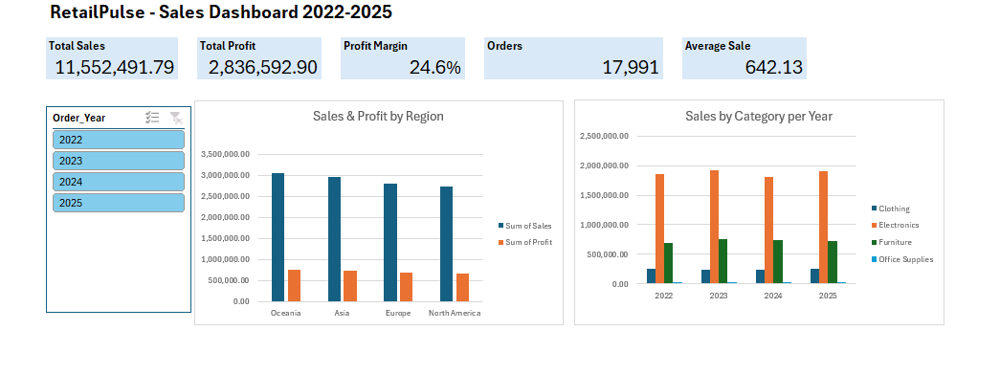

# RetailPulse – Global Sales Analysis 2022–2025 (Excel)

An end-to-end Excel project: cleaning a messy sales dataset, analysing it with formulas and PivotTables, and presenting the results in an interactive dashboard.

## Project goal
Turn 18,045 raw sales records into clean, trustworthy data and answer four business questions:
1. Which regions and product categories drive sales and profit?
2. Did sales grow from 2022 to 2025?
3. Which months are busiest and quietest?
4. Is profitability (margin) consistent across the business?

## Dataset
- **18,045 rows × 23 columns**: orders, dates, customers, region/city, category/product, price, quantity, discount, sales, cost, profit, payment, status, channel, promo code
- **Period:** January 2022 – December 2025
- Synthetic practice dataset, built with realistic data-quality problems included on purpose

## Tools and skills used
| Area | Excel features |
|---|---|
| Setup | Excel Tables, structured references, Freeze Panes |
| Data cleaning | Remove Duplicates, TRIM, PROPER, SUBSTITUTE, Find & Replace, EXACT checks, Number Filters, ROUND |
| Analysis | SUM, AVERAGE, COUNTA, MIN, MAX, SUMIFS, COUNTIFS, UNIQUE, SORT |
| Dates | YEAR, MONTH, TEXT, DATE, year-over-year growth % |
| Summaries | PivotTables, PivotCharts |
| Dashboard | KPI cards linked to analysis, Slicers with Report Connections |

## Data cleaning (documented in the `Cleaning_Log` sheet)
| Problem | Fix | Rows |
|---|---|---|
| Duplicate orders | Remove Duplicates | 45 removed |
| Inconsistent text (case, extra spaces) in Gender, Region, City, Category, Payment_Method, Order_Status | TRIM + PROPER (+ SUBSTITUTE), blanks → "Unknown" | 6 columns standardised |
| Impossible ages (4, 15, 112) | Cleared the values | 3 |
| Negative quantity | Deleted rows | 8 |
| Discount over 100% | Deleted row | 1 |
| Sales ≠ Unit_Price × Quantity × (1 − Discount) | Recalculated with ROUND | 12 fixed |

**Result:** 18,045 → **17,991 clean orders**

## Key results
| KPI | Value |
|---|---|
| Total Sales | 11,552,491.79 |
| Total Profit | 2,836,592.90 |
| Profit Margin | 24.6% |
| Orders | 17,991 |
| Average Sale | 642.13 |

## Insights
1. **Electronics drives the business:** 7.49M, about **65% of all sales**. Furniture follows with 25%, Clothing 9% and Office Supplies 1%.
2. **Order counts are almost equal across categories** (about 4,400–4,600 each), so differences in sales come from **price**, not how often customers buy.
3. **Oceania is the top region** (3.05M); **North America has the highest margin** (24.7%).
4. **Sales are flat over time:** 2.84M (2022) → 2.95M (+4.1%) → 2.82M (−4.3%) → 2.94M (+3.9%). The 2024 dip came mainly from Electronics.
5. **2025 had the 2nd-highest sales but the lowest margin (23.8%)**, which is worth investigating (discounts or costs).
6. **Busiest months:** July, December and January. **Quietest:** February and September. These are good candidates for promotions.
7. **Margins are stable at about 24–25%** across every region and category.

## Workbook structure
| Sheet | Purpose |
|---|---|
| Dashboard | KPI cards, charts and year slicer |
| Analysis | Formula-based KPIs and tables by Region, Category, Year and Month |
| Pivots / Pivot_Year | PivotTables and PivotCharts behind the dashboard |
| Clean_Data | Cleaned data as an Excel Table (`Sales`) |
| Raw_Data | Original data, untouched |
| Cleaning_Log | Every cleaning step and the rows affected |

## Repository files
| File | What it is |
|---|---|
| `RetailPulseProject_v12.xlsx` | Final workbook (dashboard, analysis, pivots, clean data, cleaning log) |
| `RetailPulse_Dashboard.png` | Dashboard screenshot |

## How to use
1. Download `RetailPulseProject_v12.xlsx`.
2. Open it in Excel 365 (UNIQUE and SORT need Excel 365 or 2021+).
3. Go to the **Dashboard** sheet and use the **Order_Year** slicer to filter the charts.

## Author
**Malleswari Kurva**
